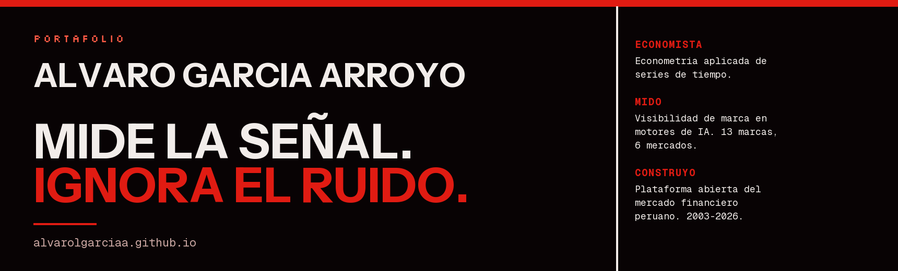

**Economista.** Decido qué se mide, con qué método, y cuándo un movimiento significa
algo en vez de ser ruido.

---

### Ahora

**Deep Learning Consultant en LLYC**, desde 2022. Dirijo la medición de visibilidad de
marca en motores de IA generativa para más de 13 marcas en seis mercados de
Latinoamérica y Norteamérica: defino los criterios que separan un movimiento
atribuible a la marca de la variación propia del motor.

### De dónde vengo

**Econometría aplicada de series de tiempo.** Proyecciones locales, GARCH, VAR, VECM y
contraste con series subrogadas. Dicté Macroeconometría Aplicada en la UPC entre 2023 y
2024. Mi tesis, sobre la transmisión de shocks de incertidumbre a los fondos mutuos
peruanos, fue presentada al Premio Renzo Rossini del BCRP.

Antes: riesgo de liquidez de fondos mutuos y monitor macroeconómico en la
**Superintendencia del Mercado de Valores**.

### Qué estoy construyendo

Una **plataforma abierta de datos del mercado financiero peruano**. Todo el histórico
que publica la SMV sobre fondos mutuos: 29 administradoras, de 2003 a hoy, en una
arquitectura por capas con cargas incrementales e idempotentes. El panel pasa de 81 MB
en CSV a 8,2 MB en Parquet, y una consulta con agregación tarda 27 ms, así que las
consultas corren en el navegador del visitante y el sitio no necesita servidor.

---

### El trabajo no está en esta página

Está en **[alvarolgarciaa.github.io](https://alvarolgarciaa.github.io/)**, con los
proyectos, la bitácora y el manual de marca del propio sitio.

### Hablamos

[LinkedIn](https://www.linkedin.com/in/alvarogarciaar) ·
[alvarolgarciaar@gmail.com](mailto:alvarolgarciaar@gmail.com)
